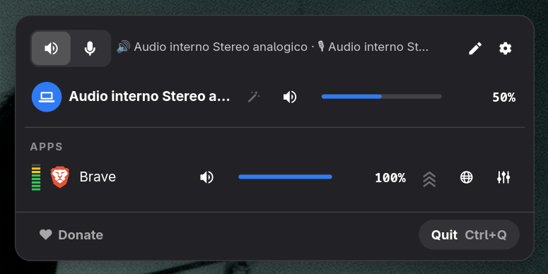
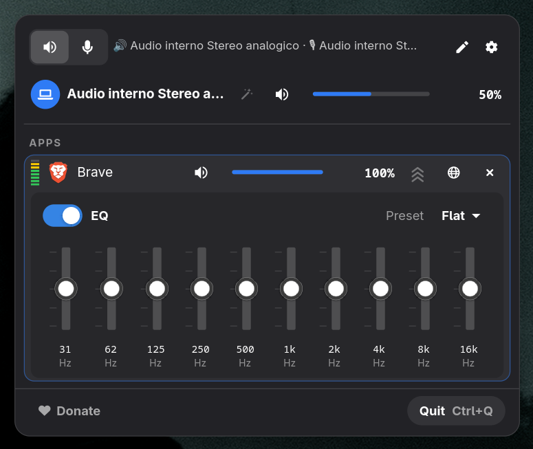
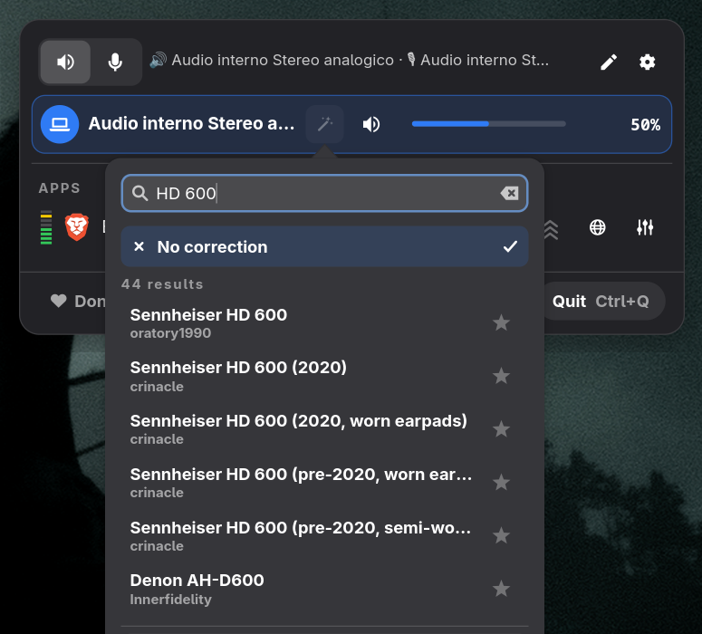
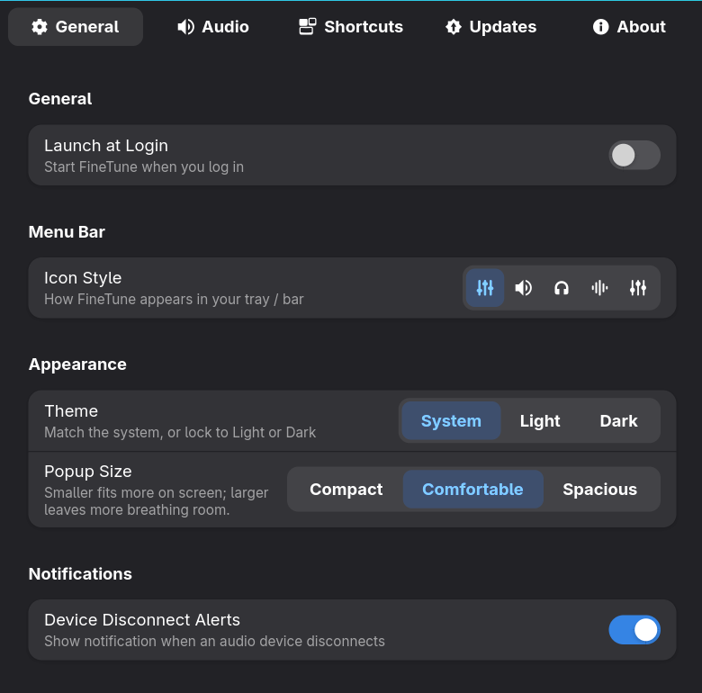

<h3>FineTune for Linux</h3>

Control the volume of every app independently, boost quiet ones up to 4x, route audio to different speakers, and shape your sound with EQ and headphone correction. Lives in your system tray. Built for PipeWire. Free and open-source.

<a href="https://github.com/HubDevCode/FineTune-Linux/releases/latest"></a>

<br clear="all"/>

<p align="center">
  <a href="https://github.com/HubDevCode/FineTune-Linux/releases/latest"></a>
  <a href="https://github.com/HubDevCode/FineTune-Linux/releases"></a>
  <a href="LICENSE"></a>
  <a href="https://github.com/sponsors/HubDevCode"></a>
  
</p>

<p align="center">
  
</p>
<p align="center">
  
</p>

## Install

**From source** (recommended)

```bash
git clone https://github.com/HubDevCode/FineTune-Linux.git
cd FineTune-Linux
scripts/install.sh          # installs to ~/.local — use `sudo scripts/install.sh /usr` for system-wide
```

The installer builds the audio engine, installs the app, the desktop entry, the icons and the `finetune://` URL handler. To remove it, run `scripts/uninstall.sh`.

**Dependencies**

| Distro | Command |
|---|---|
| Arch | `sudo pacman -S pipewire-pulse wireplumber python-gobject gtk4 libadwaita gtk4-layer-shell base-devel` |
| Debian / Ubuntu | `sudo apt install pipewire-pulse wireplumber python3-gi gir1.2-gtk-4.0 gir1.2-adw-1 libpipewire-0.3-dev build-essential` |
| Fedora | `sudo dnf install pipewire-pulseaudio python3-gobject gtk4 libadwaita gtk4-layer-shell pipewire-devel gcc make` |

Optional extras:
- `ddcutil`: speaker volume of external monitors
- `bluez`: connect paired Bluetooth devices from the popup
- `libcanberra`: volume feedback sound

## Quick Start

1. Install FineTune and launch it from your app launcher, or run `finetune`
2. Click the FineTune icon in your tray, or bind `finetune --action togglePopup` to a key. Apps playing audio appear automatically.
3. To start at login, turn on Settings → General → **Launch at Login**

That's it. Adjust sliders, route audio, and explore EQ from the popup. No permissions to grant: FineTune talks to PipeWire directly.

> **Tip:** Want FineTune to auto-switch to a specific device when you connect it? Open edit mode (pencil icon or **Ctrl+E**) and drag it above your built-in speakers. This is a one-time setup. Your preferred order is saved permanently.

## Features

### 🎚 Volume Control
- **Per-app volume** — Individual sliders and mute for each application
- **Per-app volume boost** — 2x / 3x / 4x gain presets, with a soft limiter so boosted audio never clips harshly
- **Pinned apps** — Keep apps visible in the popup even when they're not playing, so you can configure volume, EQ, and routing in advance
- **Ignore apps** — Completely disengage FineTune from specific apps. Their streams go back to the normal PipeWire route and FineTune never touches them again
- **Scroll-wheel volume** — Hover any slider in the popup, the HUD, or the EQ panel and scroll to adjust

### ⌨️ Keyboard
- **Global volume hotkeys** — Bind your own keys to **App Volume Up**, **App Volume Down**, and **App Mute**. The "app" is whichever is currently making sound, so volume-down while a YouTube tab plays behind a focused terminal turns down YouTube, not the terminal. If nothing is audible, the hotkey falls back to the focused app (Hyprland, Sway, KDE and X11 are supported).
- **Works on every compositor** — FineTune registers its actions with the XDG GlobalShortcuts portal (KDE, GNOME, Hyprland). Every action is also a command (`finetune --action …`) you can bind in any compositor. See [Keybindings](guide/keybindings.md).
- **Toggle the popup from anywhere** — Bind a key to **Toggle FineTune Popup** to open or close it on demand
- **Configurable step size** — Pick **Coarse / Normal / Fine / Extra-Fine** under Settings → Shortcuts → Volume Step. The same setting governs the volume keys, the global hotkeys, and the popup's arrow-key navigation.
- **Hold to ramp, auto-unmute on volume-up** — Holding a volume key repeats, and volume-up while muted unmutes and sets the new level in one keystroke
- **Drive the popup with the keyboard**:
  - **↑ / ↓** move between rows; the focused row autoscrolls into view
  - **← / →** adjust the focused row's volume (**Shift** = 2× step); **M** toggles mute
  - **Return / Space** opens the EQ (apps) or makes a device the default
  - **D** opens the device picker, **A** opens AutoEQ, **B** cycles the boost
  - **Tab** switches between the Output and Input tabs; **Ctrl+E** toggles edit mode; **Esc** closes

### 🔀 Audio Routing
- **Multi-device output** — Route one app to several devices at the same time
- **Audio routing** — Send apps to different outputs, or let them follow the system default
- **Device priority** — Choose which device FineTune switches to when a new device connects. If WirePlumber auto-switches to a lower-priority device, FineTune switches back. The next device in the list takes over on disconnect.
- **Auto-restore** — When a device reconnects, apps automatically return to it with their volume, routing, and EQ intact
- **Smooth switching** — Moving an app to another device crossfades instead of cutting

<p align="center">
  
</p>

### 🎛 EQ & Correction
- **10-band EQ** — 20 presets across 5 categories; double-click a band to reset it
- **User EQ presets** — Save, rename, and manage custom EQ configurations per app
- **AutoEQ headphone correction** — Search thousands of headphone profiles, or import your own ParametricEQ.txt files, for per-device frequency response correction
- **Loudness compensation** — Automatic bass and treble correction at low volumes using ISO 226:2023 equal-loudness contours, with real-time level management to keep perceived loudness consistent

### 🖥 Devices & System
- **Input device control** — Monitor microphone levels with live meters, adjust and mute them, and pick the default
- **Input lock** — Stop the system from switching your microphone when a new device connects
- **Sound effects & alert volume** — Choose the output device for notification sounds and set their volume
- **Smart volume backend** — FineTune auto-picks hardware (PipeWire/ALSA mixer), DDC, or software volume per device. If the hardware volume of a USB DAC or HDMI output doesn't change the level, force software volume from the device inspector. FineTune remembers the choice for that device.
- **Device inspector** — Shows transport, sample rate (with a picker for the PipeWire graph rate), format and output port (speakers, headphones, HDMI…). You can copy the device UID and override the software volume.
- **Hide devices & custom icons** — The eye toggle in edit mode hides devices you don't want in the list. The icon picker gives any device its own glyph.
- **Bluetooth device management** — Connect paired devices directly from the popup
- **Monitor speaker control** — Adjust volume on external displays via DDC (`ddcutil`)
- **Volume keys & HUD** — Drive the default output with your volume keys through FineTune's volume pipeline, with a Tahoe-style or Classic-style on-screen HUD. This also works on devices whose hardware volume is broken.
- **Dynamic tray icon** — Pick from five styles in Settings: Default, Speaker, Device, Waveform, Equalizer. **Speaker** follows the volume live and shows a muted glyph when muted. Every style briefly flashes the new output's icon when the device changes. Middle-click mutes, scroll changes the volume.
- **URL schemes & CLI** — Automate volume, mute, device routing, and more from scripts and launchers

### 🎨 Appearance
- **Light or Dark theme** — Settings → General → Theme follows the system or locks FineTune to Light or Dark
- **Popup density** — Settings → General → Popup Size picks **Compact / Comfortable / Spacious**

<p align="center">
  
</p>

## How It Works

FineTune for Linux has two parts:

- **`finetune-engine`** (C, `engine/`) — a real-time PipeWire client. For every app it creates a virtual sink, moves the app's streams into it, and processes the audio. The chain is volume × boost → 10-band EQ → loudness equalizer → loudness compensation. The audio is then sent to one or more output devices, each with its own AutoEQ correction, software volume and soft limiter.
- **The app** (Python + GTK 4 + libadwaita, `finetune/`) — reads and controls PipeWire through `pipewire-pulse`. It applies your settings and draws the tray icon, popup, HUD and settings window. On Wayland it uses `gtk4-layer-shell` to anchor the popup next to your bar.

If FineTune quits or its engine crashes, PipeWire removes FineTune's nodes and every app falls back to its normal output, so your audio is never left stranded. The engine restarts automatically.

## Documentation

- **[AutoEQ & Headphone Correction](guide/autoeq.md)** — Apply frequency correction from the [AutoEQ](https://github.com/jaakkopasanen/AutoEq) project, import [EqualizerAPO](https://sourceforge.net/projects/equalizerapo/) profiles, or browse [autoeq.app](https://www.autoeq.app/)
- **[URL Schemes & CLI](guide/url-schemes.md)** — Automate FineTune from the terminal, scripts, launchers or keybindings
- **[Keybindings](guide/keybindings.md)** — Volume keys and global hotkeys on Hyprland, Sway, KDE and GNOME
- **[Troubleshooting](guide/troubleshooting.md)** — Missing apps or devices, tray, popup placement, audio problems

## Contributing

- **Star this repo** — Help others discover FineTune for Linux
- **Report bugs** — [Open an issue](https://github.com/HubDevCode/FineTune-Linux/issues)
- **Contribute code** — Pull requests are welcome

### Build from Source

```bash
git clone https://github.com/HubDevCode/FineTune-Linux.git
cd FineTune-Linux
make -C engine                               # build the audio engine
bin/finetune --debug                         # run from the source tree with verbose logs
make -C engine test                          # C DSP tests
python3 -m unittest discover -s tests -t .   # Python tests
```

## Requirements

- Linux with PipeWire, `pipewire-pulse` and WirePlumber
- Python 3.10+, PyGObject, GTK 4, libadwaita 1.5+
- A StatusNotifierItem tray for the tray icon: Waybar `tray`, KDE, swaybar, or GNOME with the AppIndicator extension. Without a tray, use a keybinding to open the popup.

Settings are stored in `~/.config/FineTune/settings.json`. AutoEQ data lives in `~/.local/share/FineTune/`.

## Support

FineTune for Linux is free and open source, forever. If it made your day a little easier, you can support its development — but genuinely not expected 🙏

[](https://github.com/sponsors/HubDevCode)

## Credits

FineTune for Linux is created and maintained by [HubDevCode](https://github.com/HubDevCode).
It is a Linux reimplementation inspired by and based on [FineTune for macOS](https://github.com/ronitsingh10/FineTune) by Ronit Singh, which is also released under the GPL v3.

## Previous version

The original Rust implementation of FineTune-Linux is deprecated and no longer maintained.
It is kept for reference in the [`old-rust`](https://github.com/HubDevCode/FineTune-Linux/tree/old-rust) branch.

## License

[GPL v3](LICENSE)
